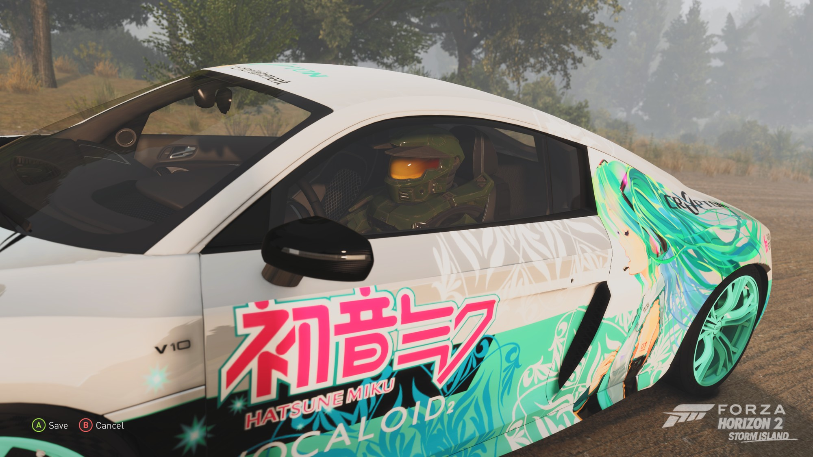

# FH2 Master Chief



Drive as Master Chief in Forza Horizon 2. The armour comes from Forza Horizon 6 and is picked in FH2 Extra Options'
**Player Character** setting.

This is an unofficial fan mod. It is not made by, endorsed by or connected to Microsoft, Xbox Game Studios,
Playground Games, Turn 10 Studios or Halo Studios.

## What you need

- Forza Horizon 2 running on PC through [Azimuth](https://almost-there-games.itch.io/azimuth)
- [FH2 Extra Options](https://github.com/RokkuDayo/ForzaHorizon2_ExtraOptions/releases) **0.6.0** (the Azimuth build) installed in Azimuth

## Install

1. Close the game.
2. Download **`MasterChief.zip`** from the [latest release](../../releases/latest).
3. Open your Azimuth folder (the one with `azimuth.exe` in it), then open `mods`, then `Forza Horizon 2`.
4. Unzip `MasterChief.zip` into that folder. You should now have this:

   ```
   Azimuth
   └── mods
       └── Forza Horizon 2
           ├── loadorder.txt
           └── Master Chief
               ├── mod.json
               ├── database.json
               └── media
   ```

   If you get `Master Chief\Master Chief\mod.json`, move the inner `Master Chief` folder up one level.
5. Open `loadorder.txt` (same folder) with Notepad. If there's no line `Master Chief`, add it at the end as its own
   line and save.
6. Start the game, then go to **Options > Player Character** and pick **MasterChief**. In Photo Mode, **Photo Driver**
   works the same way.

## Update

Close the game, delete the `Master Chief` folder and do steps 2 to 4 again. `loadorder.txt` stays as it is.

## Uninstall

Close the game, delete `mods\Forza Horizon 2\Master Chief` and remove the `Master Chief` line from `loadorder.txt`.

## Not working?

- **MasterChief isn't in the Player Character list:** check that the folders look like step 4 and that
  `Master Chief` is in `loadorder.txt`. You need Extra Options 0.6.0; older versions keep mods somewhere else.
- **Still not working:** open an [issue](../../issues) and attach `FH2_ExtraOptions.log` from your Azimuth folder.

## License

The code is GPL-3.0, see [LICENSE](LICENSE). Forza Horizon, Halo and Master Chief belong to their owners.
